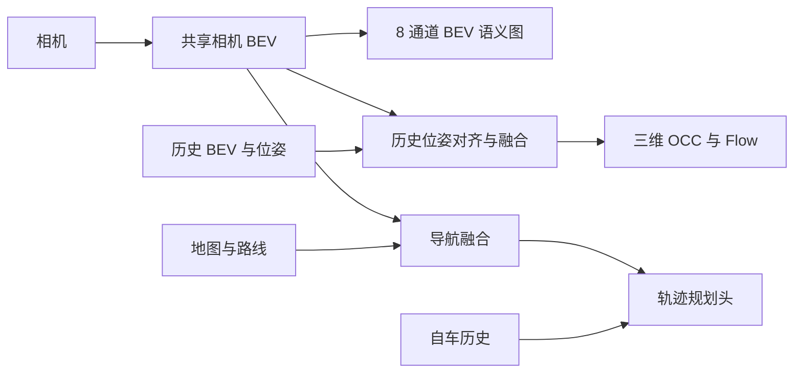

# 共享 BEV：轨迹、语义图、三维 OCC 和 Flow

本实现基于 `fix/reactive-bev-learning`。一个 AutoE2E 网络共享相机骨干和
当前 BEV，输出自车轨迹、原有 8 通道 BEV 语义图、三维语义占用和体素运动速度。
独立 3D 检测框不在此次范围内。



OCC/flow 的损失能回传到共享相机骨干和 BEV。它们不读取导航地图，也没有
把预测结果直接送回规划头；新增感知能力不代表已完成基于 OCC 的闭环避障。
这里的 flow 是当前坐标系中的物理运动速度，未来多个时刻的 OCC 还需要独立预测模块。

## 快速验证

在已安装项目依赖的环境里，从仓库根目录执行：

```bash
cd Model
python -m inference.occ_flow_demo --device cpu --steps 2 --output /tmp/occ-flow-smoke
```

这条命令使用真实 ResNet50（无需下载权重）、小网格和合成标签，执行联合优化、
评估及两帧流式推理，生成：

- `checkpoint.pt`：模型、网格约定、优化器和损失配置；
- `smoke.json`：损失、IoU、运动误差和输出形状；
- `scene.npz` / `scene.json`：可复用结果和坐标、单位、类别元数据；
- `scene.svg`：占用俯视图、运动向量和积分后的自车轨迹。

它验证执行、接口和梯度，合成数据上的数值不能用于衡量真实感知效果。

## 启用与推理

新功能默认关闭。原有模型参数、控制输出和未启用时的 state_dict 保持兼容。
`configs/shared_bev_occ_flow.json` 提供联合训练配置，默认使用 fix 分支的 GRU
规划头；可选择 `planner_mode="bezier"` 保留 main 的规划结构。

```python
import torch
from model_components.auto_e2e import AutoE2E
from inference.scene_prediction import predict_scene

model = AutoE2E(
    is_pretrained=False,
    planner_mode="bezier",
    enable_bev_segmentation=True,
    enable_occupancy=True,
    occupancy_kwargs={"grid_shape": (16, 180, 120)},
).eval()

# inputs 使用原有 camera_tiles、map_context、visual_history、
# egomotion_history，以及 projection、geometry_type 等参数。
scene = predict_scene(model, inputs, initial_speed_mps=initial_speed_mps)
```

`predict_scene` 要求 `model.eval()`，在 inference_mode 下返回：

| 输出 | 形状与含义 |
|---|---|
| `trajectory_controls` | `[B,64,2]`，加速度 / 曲率 |
| `trajectory_xy_m` | `[B,64,2]`，用原有运动学积分得到的位置 |
| `bev_semantic_probabilities` | `[B,8,Hbev,Wbev]`，启用现有语义头时输出 |
| `occupancy_labels` | `[B,Z,X,Y]`，体素类别 |
| `occupancy_probability` | `[B,Z,X,Y]`，非空概率 |
| `flow_mps` | `[B,2,Z,X,Y]`，物体体素的 x/y 物理速度 |
| `flow_valid` | `[B,Z,X,Y]`，预测类别属于配置的物体类别；不是真值有效性掩码 |
| `bev_occupancy_labels` / `bev_occupancy_probability` | `[B,X,Y]`，高度投影 |
| `bev_flow_mps` | `[B,2,X,Y]`，物体体素运动在高度方向的平均 |
| `grid` | 范围、轴向、体素尺寸、类别、单位等元数据 |

`include_probabilities=True` 可额外返回全部类别概率。
底层 `model(..., mode="infer", return_auxiliary=True)` 返回
`(controls, aux)`，其中 `occupancy_logits` 为 `[B,K,Z,X,Y]`，
`occupancy_flow_mps` 为未按预测类别过滤的 `[B,2,Z,X,Y]` 速度。
默认 `mode="infer"` 仍只返回原来的控制张量。

## 坐标与类别约定

- 坐标为 ego-FLU：x 向前、y 向左、z 向上，长度单位为米。
- 体素张量轴是 `Z,X,Y`。z 从最小高度递增；行从 x 最大值递减，列从 y 最大值递减，
  与 AutoE2E 相机 BEV 一致。采样采用体素中心和 `align_corners=False`。
- 默认 OCC 网格为 `(16,180,120)`，范围与当前 BEV 相同：
  `[-60,-60,-5,120,60,3]`。体素尺寸为 `(1.0,1.0,0.5)` 米。
  当前相机 / 规划 BEV 仍为 `450×300`，OCC 在独立分支降采样，减小显存。
- `occupancy_kwargs` 可设置 `pc_range` 和 `grid_shape`。例如 Apollo 风格的
  `pc_range=(-50,-50,-5,50,50,3), grid_shape=(16,200,200)`；XY 必须位于相机 BEV
  范围内。代码按米制坐标重采样，不把不同范围简单 reshape。
- 默认 16 个非空语义类别使用 Apollo / nuScenes 类别序列，最后一类 `empty`，
  共 17 类，采用 softmax。`255` 为未知标签，不参与监督。
- 类别 0～9 为物体类别，包含车、人、自行车、锥桶和护栏。速度监督支持静止物体
  的零速度；背景和空体素不参与 flow 损失。可配置 `class_names` 和 `dynamic_classes`。
- flow 的单位是 **m/s**，是在当前自车轴向表达的物体物理速度。
  静止障碍物应为零；不能直接使用含自车运动的像素位移或体素位移。

新模块借鉴 Apollo 的“BEV → 高度特征 → OCC / flow”设计，使用原生 PyTorch
重新实现，不引入 MMCV，不直接加载 Apollo 检查点。解码结构采用轻量空间卷积、
高度提升和深度可分离 3D 卷积；损失为带有效性掩码的 focal CE、非空类别 Dice 和物体 L1 速度。

## 历史帧

压缩的 `visual_history` 仍用于规划。OCC/flow 使用独立的空间历史：

| 参数 | 约定 |
|---|---|
| `history_bev_features` | `[B,T,C,Hbev,Wbev]`，各帧自身 ego 坐标中的相机 BEV |
| `history_to_current` | `[B,T,4,4]`，历史 ego 到当前 ego 的刚体变换 |
| `history_age_s` | `[B,T]`，当前时间减历史时间，有限正数 |
| `history_valid` | 可选 `[B,T]`，无效历史帧不参与融合 |

支持平面 yaw / 平移；pitch / roll 无法由 2D BEV 精确补偿，接口会拒绝这些变换。
融合按时间衰减和逐格门控加权，并使用采样支持掩码，超出历史视域的位置不参与。
没有历史时使用当前 BEV，不创建跨 batch 的隐式状态。

`model.encode_bev_history(camera_history, projections=..., geometry_type=...)`
可把 `[B,T,V,3,H,W]` 原始历史图像编码为 BEV，使用共享相机网络。
每帧需要自己的投影算子。默认停止历史梯度节省内存，可用 `detach=False` 端到端训练。

连续在线推理使用 `OccupancyFlowStream(model)`：每个场景流单独创建对象，调用
`predict(inputs, initial_speed_mps=..., world_from_ego=..., timestamp_s=..., sequence_id=...)`。
它保存分离后的 BEV，计算真实时间差和历史到当前的位姿变换；场景 ID 变化会重置。
支持 `reset()`、历史长度和最大年龄配置；同一场景时间戳必须递增，batch 必须为 1。

## 联合训练接口

数据从哪里来由调用方决定。`SceneMultitaskObjective` 和 `run_scene_epoch` 接受
已有反应式训练 batch，并增加以下字段：

| 字段 | 形状 |
|---|---|
| `occupancy_target` | `[B,Z,X,Y]`，整数类别，未知为 255 |
| `occupancy_valid` | `[B,Z,X,Y]`，有效监督区域 |
| `flow_target_mps` | `[B,2,Z,X,Y]`，物理速度 |
| `flow_valid` | `[B,Z,X,Y]`，有可靠运动标签的体素 |

这些标签必须与模型网格、轴向及类别一致，不会自动推断它们的来源或坐标。
未观测区域不能当作空闲。流损失先选有效物体再计算，因此被屏蔽的 NaN 标签不会
污染梯度。无物体或全无效的 batch 返回可回传的零损失。

启用原有任务时仍需 `trajectory_xy_m`、`trajectory_valid`、`initial_speed_mps`、
`bev_segmentation_target`、`bev_segmentation_valid`、`bev_segmentation_available`、
`route_mask`、`route_channel_valid` 等字段。对应任务权重为零时可以不提供其标签。
OCC / flow 两项权重都为零时可不提供占用标签；单独开启 flow 仍需要占用类别及掩码。

历史可以直接提供上述 BEV 字段，也可提供：

- `history_camera_tiles`：`[B,T,V,3,H,W]`；
- `history_camera_projection_matrix`：标定针孔图像的 `[B,T,V,3,4]`；
- 对应的历史位姿、年龄和有效性。

训练 runner 会用共享骨干编码历史帧；默认历史梯度停止，当前帧及 OCC / flow 头参与优化。
其他投影类型可先用各帧自己的投影算子调用 `encode_bev_history`，再传入 BEV。

```python
from training.scene_multitask import SceneMultitaskObjective, run_scene_epoch

objective = SceneMultitaskObjective().to(device)
optimizer = torch.optim.AdamW(model.parameters(), lr=1e-4)
losses = run_scene_epoch(model, loader, objective, optimizer, device=device)
```

若已把 batch 字典保存为 `torch.save([batch, ...], path)`，可直接使用入口：

```bash
cd Model
python -m training.train_scene \
  --config configs/shared_bev_occ_flow.json \
  --train-batches /path/train_batches.pt \
  --validation-batches /path/validation_batches.pt \
  --epochs 10 --device cuda --output /path/scene_training
```

`--resume /path/checkpoint.pt` 可恢复模型、优化器和损失状态。
采用独立的 scene runner，避免原有 L2D 阶段自动停用感知头。
生产训练建议通过 Python loader 流式提供 batch，CLI 的 `.pt` 批次入口适用于已打包的小批验证。

`evaluate_scene` 输出联合任务损失、类别 IoU / 非空 mIoU、占用 precision / recall，
以及有效物体体素上的速度 EPE（m/s）。没有有效速度标签时 EPE 为 `None`。
`save_scene_checkpoint` 保存类别、范围、轴向与单位；加载时拒绝不一致的网格或损失配置。

## 验证命令

```bash
make lint typecheck
python -m pytest -q Model/tests/test_shared_bev_occ_flow.py
```

测试覆盖非正方形网格、正负轴向的位姿对齐、yaw 旋转、越界 / 无效历史、
未知标签、静止 / 无物体 flow、共享梯度和导航隔离、Bezier / GRU 轨迹兼容、
联合优化、检查点恢复、流式场景重置及结果导出。

本次 CPU 验证记录：

- 新增功能测试共 24 项；与原有多任务及 World Model 回归测试一起运行，**98 项通过**。
- `make lint typecheck` 通过；新增 7 个运行模块的 `mypy --check-untyped-defs` 通过。
- 真实 ResNet50 的两步联合优化、评估、两帧历史推理与结果导出通过。
- 训练 CLI 的训练、验证及模型 / 优化器检查点恢复通过。
- 默认 `450×300` BEV → `17×16×180×120` OCC / `2×16×180×120` flow 的头部
  前向和反向通过，共享 BEV 和全部新增头参数梯度有限。

全量测试未通过：基分支 `65f1149` 已有三个缺失的 Platform 模块
（`bevformer_v2_occupancy`、`bevformer_v2_runtime`、`occupancy_store`），
环境还缺少其 Ray/Flyte 插件依赖，导致四项收集错误。另有原有 Bezier
`visual_history_proj` 未被前向使用的梯度测试失败。这些问题都在未修改的基分支
复现；本次没有修改原有规划行为来消除它们。

未使用真实数据或 GPU，因此本次验证不包含真实精度、闭环避障或 GPU 性能结论。
